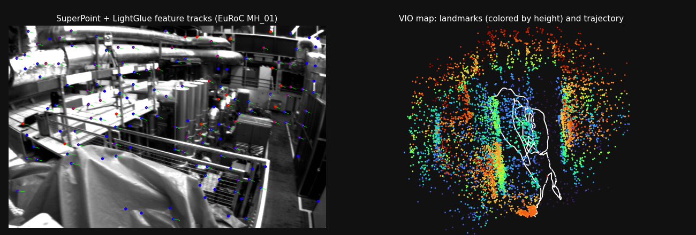
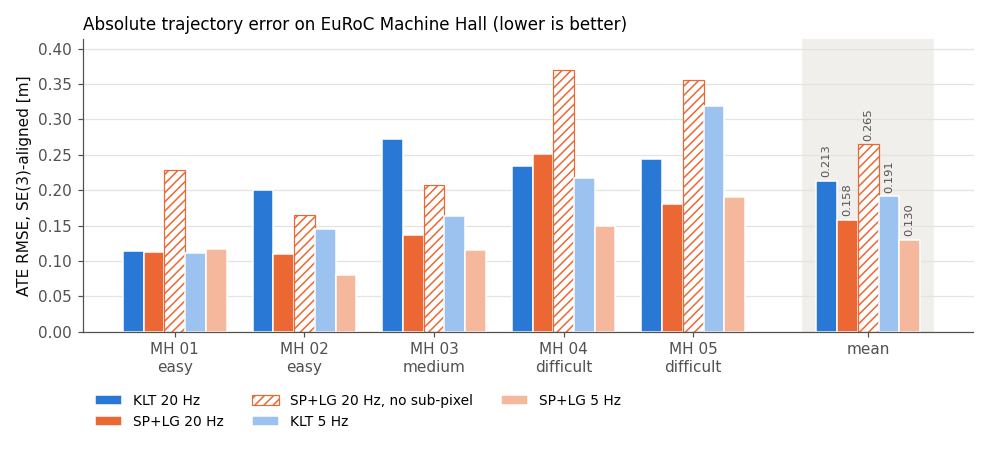
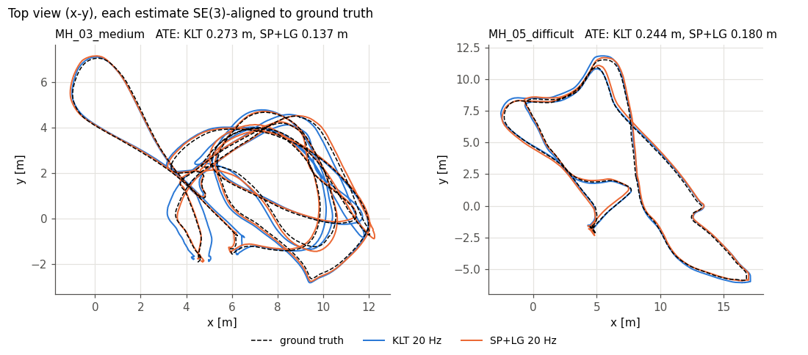

# DEEP_VIO: Monocular Visual-Inertial Odometry with Learned Front-Ends
### C++ · GTSAM · ONNX Runtime · EuRoC MAV



DEEP_VIO is a tightly coupled monocular visual-inertial odometry system written from scratch in
C++ to learn SLAM/VIO end to end. A classical pipeline (KLT tracking, IMU preintegration, and a
GTSAM fixed-lag smoother) is the baseline. Learned components are swapped in one at a time and
must beat it on EuRoC. The first learned stage, a **SuperPoint + LightGlue** front-end running
in C++ through ONNX Runtime, lowers the mean trajectory error on EuRoC Machine Hall by **26 %**.

## TODO List
- [x] EuRoC loader, SO(3) and camera models, triangulation (hand-written, unit-tested)
- [x] On-manifold IMU preintegration (hand-written, checked against GTSAM)
- [x] KLT front-end and GTSAM fixed-lag smoother back-end (classical baseline)
- [x] Evaluation tooling: ATE with Umeyama alignment, batch runs, plots
- [x] SuperPoint + LightGlue front-end in C++ via ONNX Runtime
- [x] 3-D map export (PLY)
- [ ] Keyframe-policy tuning (both front-ends score better at 5 Hz than at 20 Hz)
- [ ] Real-time learned front-end (fp16 LightGlue / TensorRT)
- [ ] Learned inertial odometry: network-predicted IMU displacement and covariance as a factor
- [ ] Evaluation on the EuRoC Vicon Room sequences (V1/V2)
- [ ] Loop closure

## Pipeline
```
 cam0 (20 Hz) ──► front-end ──────────────► feature tracks (id, undistorted px)
                  KLT | SuperPoint+LightGlue          │
 imu0 (200 Hz) ─► IMU preintegration ──────────────┐  │
                                                   ▼  ▼
                  static init ──► keyframe? ──► fixed-lag smoother (GTSAM, 3 s window)
                                      │          pose / velocity / bias per keyframe + landmarks
                                      └──no──► IMU-propagated pose (20 Hz output)
```
| Module | File | What it does |
|---|---|---|
| Dataset | `src/dataset/euroc_dataset.cpp` | One packet per image with the IMU samples in `(t_prev, t]`, int64 ns timestamps |
| KLT front-end | `src/frontend/klt_tracker.cpp` | CLAHE, pyramidal LK with forward-backward check, F-matrix RANSAC, Shi-Tomasi with min spacing |
| Learned front-end | `src/frontend/superpoint_lightglue_tracker.cpp` | SuperPoint keypoints, LightGlue matching to the previous frame, sub-pixel LK refinement, RANSAC |
| ONNX wrapper | `src/dl/onnx_model.cpp` | ONNX Runtime session on the CUDA provider, CPU fallback |
| Static init | `src/imu/static_initializer.cpp` | Gravity direction and gyro bias from 1 s of stationary IMU data |
| Preintegration | `src/imu/preintegration.cpp` | Forster et al. on-manifold preintegration (reference; the back-end uses GTSAM's) |
| Back-end | `src/backend/vio_estimator.cpp` | `CombinedImuFactor` + Huber projection factors, DLT-triangulated landmarks, prediction gating, zero-velocity updates, `BatchFixedLagSmoother` |

Both front-ends implement the same `FeatureTracker` interface and are selected with
`tracker.type` in the config; the back-end is identical for both. Monocular VIO gets metric
scale from the IMU, so Sim(3)- and SE(3)-aligned errors are nearly identical (scale 0.98–1.00).

## Data Preparation
Download the [EuRoC MAV dataset](https://projects.asl.ethz.ch/datasets/doku.php?id=kmavvisualinertialdatasets)
in ASL format (Machine Hall, MH_01–MH_05). Only `cam0`, `imu0` and
`state_groundtruth_estimate0` are used. The scripts expect this layout (`EUROC_ROOT` overrides
the root):
```Shell
├── datasets
    ├── euroc
        ├── machine_hall
            ├── MH_01_easy
                ├── MH_01_easy
                    ├── mav0
                        ├── cam0
                        ├── imu0
                        ├── state_groundtruth_estimate0
            ├── MH_02_easy
            ├── MH_03_medium
            ├── MH_04_difficult
            ├── MH_05_difficult
```

## Requirements
Tested on Ubuntu 22.04 with GCC 11, an RTX 3070 Ti laptop GPU and CUDA driver 595.
- CMake ≥ 3.16, Eigen 3.4, OpenCV 4
- GTSAM 4.3.0, built locally against the system Eigen and without TBB by the script below
- Optional, for the learned front-end: ONNX Runtime 1.31.1 (CUDA 12 build), CUDA ≥ 12.8 and
  cuDNN 9. The CUDA and cuDNN libraries are taken from PyTorch's cu128 pip wheels
  (`NVIDIA_PY_DIR` in CMake) and linked directly, so an older CUDA on `LD_LIBRARY_PATH` cannot
  shadow them.
- Python 3 with numpy and matplotlib, for evaluation and plots

```shell
./scripts/build_gtsam.sh               # ~15 min, installs to third_party/install
./scripts/fetch_learned_frontend.sh    # optional: ONNX Runtime + SuperPoint/LightGlue models
cmake -S . -B build && cmake --build build -j
```
CMake enables the GTSAM back-end and the learned front-end automatically when it finds them in
`third_party/`.

## Models
The learned front-end uses the [LightGlue-ONNX](https://github.com/fabio-sim/LightGlue-ONNX)
v1.0.0 exports, downloaded by `scripts/fetch_learned_frontend.sh`:
```Shell
├── third_party
    ├── models
        ├── superpoint.onnx                        # keypoints + 256-d descriptors
        ├── superpoint_lightglue_fused.onnx        # matcher, CUDA (fused attention)
        ├── superpoint_lightglue_fused_cpu.onnx    # matcher, CPU
        ├── superpoint_lightglue_fused_fp16.onnx   # matcher, CUDA fp16 (not used yet)
    ├── onnxruntime-linux-x64-gpu_cuda12-1.31.1
```
The CUDA matcher uses a GPU-only attention kernel. To run on the CPU, set `use_cuda: 0` and
point `lightglue_model` at the `_cpu` file (about 210 ms/frame instead of 25 ms).

## Evaluation
ATE is the RMSE of the position error after aligning the online (causal) pose at every camera
frame to ground truth with Umeyama SE(3) alignment (`scripts/eval_ate.py`).

Run one sequence and evaluate it:
```Shell
M=datasets/euroc/machine_hall/MH_01_easy/MH_01_easy/mav0
./build/run_euroc $M config/euroc_mono.yaml mh01_klt.txt                  # KLT
./build/run_euroc $M config/euroc_mono_superpoint.yaml mh01_splg.txt      # SuperPoint+LightGlue
python scripts/eval_ate.py $M/state_groundtruth_estimate0/data.csv mh01_splg.txt --plot mh01.png
```
Run all Machine Hall sequences (results in `results/runs/`):
```Shell
PYTHON=python ./scripts/eval_euroc.sh config/euroc_mono.yaml
OUT=$PWD/results/runs/superpoint PYTHON=python JOBS=2 ./scripts/eval_euroc.sh config/euroc_mono_superpoint.yaml
OUT=$PWD/results/runs/superpoint_stride4 RUN_ARGS="--stride 4" PYTHON=python JOBS=2 \
  ./scripts/eval_euroc.sh config/euroc_mono_superpoint.yaml                # 5 Hz stress test
```

ATE RMSE [m] on EuRoC Machine Hall (SE(3) alignment, single run each):

| sequence | KLT 20 Hz | SP+LG 20 Hz | SP+LG, no sub-pixel | KLT 5 Hz | SP+LG 5 Hz |
|---|---|---|---|---|---|
| MH_01_easy | 0.114 | 0.112 | 0.229 | 0.112 | 0.117 |
| MH_02_easy | 0.201 | **0.110** | 0.165 | 0.146 | **0.080** |
| MH_03_medium | 0.273 | **0.137** | 0.207 | 0.164 | **0.115** |
| MH_04_difficult | **0.235** | 0.251 | 0.369 | 0.217 | **0.150** |
| MH_05_difficult | 0.244 | **0.180** | 0.356 | 0.318 | **0.190** |
| **mean** | 0.213 | **0.158** | 0.265 | 0.191 | **0.130** |

Bold marks the better front-end at the same camera rate. "5 Hz" is `run_euroc --stride 4`:
every 4th image is used and all IMU data is kept, giving 4x larger inter-frame motion. "No
sub-pixel" is SP+LG without the LK refinement step.





Findings:
1. **The learned front-end lowers mean ATE by 26 % at 20 Hz and 32 % at 5 Hz** against KLT at
   the same rate. MH_04 (dark, fast) is the one sequence where it is not better at 20 Hz.
2. **Sub-pixel refinement is essential.** SuperPoint keypoints lie on the integer pixel grid.
   Without refinement, SP+LG is worse than KLT (0.265 m). LightGlue decides *which* point
   matches, and a single-level LK step decides *where* it is.
3. **KLT tolerates 5 Hz on EuRoC**, but degrades on MH_05 (0.244 → 0.318 m), where SP+LG
   stays stable.
4. **Both front-ends improve at 5 Hz**, so the 20 Hz keyframe policy is not optimal.

| cost | KLT | SP+LG |
|---|---|---|
| front-end time per frame | 5–8 ms (CPU) | 25 ms (GPU), about 210 ms (CPU) |
| frame-to-frame track survival (MH_01) | 91 % | 84 % |

The back-end averages 27–45 ms per frame, with spikes up to about 340 ms. SP+LG plus the
back-end is about 60 ms/frame at 20 Hz, slightly over real time. ONNX Runtime on the GPU is
not bit-exact between runs, so differences of ±0.01–0.02 m should not be over-interpreted.
More detail: [results/baseline_classical.md](results/baseline_classical.md) and
[results/learned_frontend.md](results/learned_frontend.md). The figures are regenerated with
`python scripts/plot_results.py` and `scripts/make_teaser.py`.

## Visualization
Feature tracks (blue = new, red = long-lived, green = motion since the previous frame):
```Shell
./build/track_euroc $M config/euroc_mono.yaml --viz
./build/track_euroc $M config/euroc_mono_superpoint.yaml --viz
```
Live tracks during a VIO run, and a 3-D map (landmarks colored by height, trajectory as a white
polyline) for MeshLab or CloudCompare:
```Shell
./build/run_euroc $M config/euroc_mono.yaml mh01.txt --viz --ply results/maps/MH_01_easy_klt.ply
meshlab results/maps/MH_01_easy_klt.ply
```
Raw vs undistorted images and IMU samples per frame:
```Shell
./build/play_euroc $M
```

## Tests
```Shell
EUROC_DIR=$PWD/$M ./build/deep_vio_tests      # dataset, SO(3), camera, triangulation, IMU
./build/deep_vio_gtsam_tests                  # hand-written math vs GTSAM, toy optimization
EUROC_DIR=$PWD/$M ./build/deep_vio_dl_tests   # SuperPoint CUDA vs CPU, LightGlue geometry
```

## License
No license has been chosen for this repository yet. Third-party components keep their own
licenses: GTSAM (BSD), ONNX Runtime (MIT), LightGlue and LightGlue-ONNX (Apache-2.0). The
SuperPoint weights are released by Magic Leap for non-commercial use only.

## Citation
If you use this code, please cite the repository:
```bibtex
@misc{mahajan2026deepvio,
  title        = {{DEEP\_VIO}: Monocular Visual-Inertial Odometry with Learned Front-Ends},
  author       = {Mahajan, Parth},
  year         = {2026},
  howpublished = {\url{https://github.com/mahajanparth/DEEP_VIO}}
}
```
DEEP_VIO builds on these works:
```bibtex
@inproceedings{detone2018superpoint,
  title     = {{SuperPoint}: Self-Supervised Interest Point Detection and Description},
  author    = {DeTone, Daniel and Malisiewicz, Tomasz and Rabinovich, Andrew},
  booktitle = {CVPR Workshops},
  year      = {2018}
}
@inproceedings{lindenberger2023lightglue,
  title     = {{LightGlue}: Local Feature Matching at Light Speed},
  author    = {Lindenberger, Philipp and Sarlin, Paul-Edouard and Pollefeys, Marc},
  booktitle = {ICCV},
  year      = {2023}
}
@article{forster2017preintegration,
  title   = {On-Manifold Preintegration for Real-Time Visual-Inertial Odometry},
  author  = {Forster, Christian and Carlone, Luca and Dellaert, Frank and Scaramuzza, Davide},
  journal = {IEEE Transactions on Robotics},
  year    = {2017}
}
@article{burri2016euroc,
  title   = {The {EuRoC} Micro Aerial Vehicle Datasets},
  author  = {Burri, Michael and Nikolic, Janosch and Gohl, Pascal and Schneider, Thomas and
             Rehder, Joern and Omari, Sammy and Achtelik, Markus W. and Siegwart, Roland},
  journal = {The International Journal of Robotics Research},
  year    = {2016}
}
```
